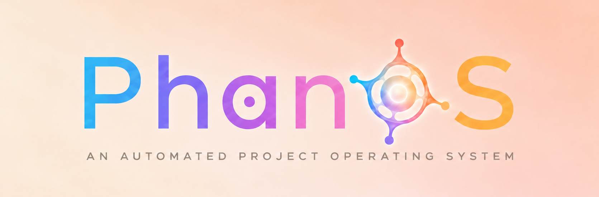

  

  <strong>The engine your AI plugs into, to get real work done on your PC.</strong>

  Under construction. Beta access to the PhanOS Builder app can be requested at <a href="https://phanos.eu">phanos.eu</a> (website under construction, its information may be outdated). 
  Star and watch this repository to hear about what comes next.

 

## A step beyond Office

Microsoft Office changed what a Windows PC was for. It bundled the everyday kinds of work into one suite, and the computer stopped being a box of separate programs and became a place where things got finished.

PhanOS takes that idea a step further. Instead of a suite of applications that you operate, it is an engine that an AI plugs into, plus a growing set of workflow plugins that teach the AI how to do each kind of job. The AI can be local or hosted, whichever you prefer. You decide how much freedom it gets, from checking with you before every step to running a whole job on its own.

## A model made for the job

PhanOS will ship with its own fine-tuned model, trained for the everyday work that Cyphor does. Keeping track of a project, reading and organising its files and checking results are small, constant jobs. A model built for exactly those jobs handles them on your own machine and keeps your graphics card free for everything else.

You are never locked in. Whenever a task calls for more power, or you simply prefer it, PhanOS works with hosted models from the larger providers too.

| Where the work runs | Good for |
| --- | --- |
| The PhanOS model, on your machine | Everyday project work, private by default, light on your GPU |
| A hosted model from a larger provider | Heavy lifting, whenever you choose to use it |

## PhanOS Builder

Builder is the first app on the engine, and it is almost finished. It is a full project operating system for Windows, and it runs on Linux too. Its first workflow plugin is for coding.

A built-in orchestrator plans the work, hands pieces to several AI agents at once, checks what comes back and keeps a record of every step. Let it run fully autonomously, or stay in the loop and approve as you go. It is the same engine either way, and the choice is yours.

What it sets out to solve:

- **Projects stop living in one fragile chat.** Context, decisions and progress belong to the project, so any session can pick up exactly where the last one stopped.
- **Agents stop stepping on each other.** Every piece of work has an owner, so many agents can work in parallel without overwriting one another.
- **"Done" gets checked.** Results are verified before they count, not just reported.

Coding is the first plugin, not the last. Other jobs will follow on the same engine.

## PhanOS, the operating system

A full Linux operating system built on this engine is already in development. Linux stays underneath. What changes is who does the operating: you say what you want, and the system takes care of the rest.

How it looks and feels is staying a secret for now. We think it will be worth the wait.

### Safer by the way it works

Security is part of how PhanOS operates, not an add-on. It is designed so that:

- everything the AI writes is signed, so tampering gets noticed
- your keys and passwords stay locked away, and the AI can use them without ever seeing them
- programs get narrow, temporary access instead of the run of your machine

## Safer websites with Graft

Graft packages something so that another party can understand it, use it and trust where it came from. Applied to the web, a site hands each visitor's AI a graft instead of making the visitor run a pile of the site's code, and grants only the access that visit needs.

Much of what attackers go after on a typical website, such as templates, forms and session handling, no longer has to run on the server. Less code to attack means fewer ways in.

## Cyphor and the open core

Cyphor is the layer underneath it all. It keeps track of what a project contains and shows when something has been changed behind your back.

The business model is still being worked out. The goal is to open source at least the core, so that anyone can use Cyphor to build trustworthy infrastructure across the entire web.

## Where things stand

| Piece | Status |
| --- | --- |
| PhanOS Builder | Almost finished, for Windows and Linux |
| PhanOS operating system | In development |
| Cyphor | Being prepared for release |
| Graft | In development |
| phanos.eu | Website under construction and its information may be outdated, Beta access requests for PhanOS Builder are open |

## Follow along

This page is a placeholder while the real thing is built. **Star** this repository and **watch** it to get future updates, and request Beta access to the PhanOS Builder app at [phanos.eu](https://phanos.eu) (website under construction, its information may be outdated).
